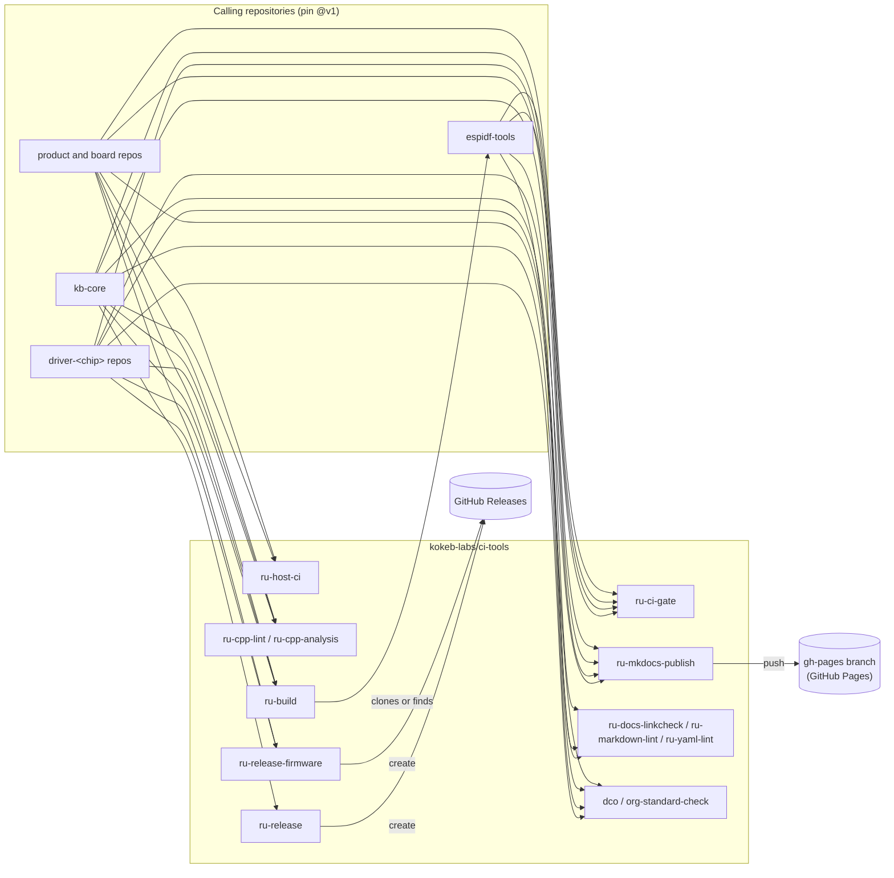

# ci-tools

Reusable GitHub Actions workflows for every Kokeb Labs repository: C/C++ lint and analysis, host CMake builds,
ESP-IDF firmware builds and releases, the MkDocs documentation platform, link and lint checks, the DCO sign-off and
organisation-standard checks, releases and a single required CI gate. Every caller uses one place:

```yaml
uses: kokeb-labs/ci-tools/.github/workflows/<name>.yml@v1
```

[](https://github.com/kokeb-labs/ci-tools/actions/workflows/ci-self.yml)
[](https://kokeb-labs.github.io/ci-tools/latest/)
[](LICENSE)
[](https://github.com/kokeb-labs/ci-tools/releases)

**Documentation: <https://kokeb-labs.github.io/ci-tools/latest/>**

| Page | What it covers |
| --- | --- |
| [Quickstart](https://kokeb-labs.github.io/ci-tools/latest/quickstart/) | The smallest CI for a repository, pinned to `@v1`, with the gate |
| [Workflow catalogue](https://kokeb-labs.github.io/ci-tools/latest/workflows/) | Every reusable workflow: purpose, jobs, permissions, inputs, failure modes |
| [Versioning](https://kokeb-labs.github.io/ci-tools/latest/VERSIONING/) | Tags, the moving `v1`, what is breaking, releases from the changelog |
| [Permissions contract](https://kokeb-labs.github.io/ci-tools/latest/permissions/) | What each workflow needs from its caller |
| [ESP-IDF quickstart](https://kokeb-labs.github.io/ci-tools/latest/esp-idf-quickstart/) | ESP32 example builds with `ru-build`, firmware releases |
| [Docs platform](https://kokeb-labs.github.io/ci-tools/latest/docs-platform/) | The theme package, the publish workflow, migration and the style guide |

## Architecture



Each workflow is self-contained. It calls only third-party actions, which are
pinned to commit SHAs, and never another workflow of this repository at a
moving ref. Pinning a caller to `@v1` therefore pins everything it runs.

| Workflow | Purpose |
| --- | --- |
| [`ru-ci-gate.yml`](.github/workflows/ru-ci-gate.yml) | One required check that passes only if every job passed ([guide](docs/ru-ci-gate.md)) |
| [`ru-host-ci.yml`](.github/workflows/ru-host-ci.yml) | CMake configure/build/ctest, then clang-tidy 18 and cppcheck on the compile database ([guide](docs/ru-host-ci.md)) |
| [`ru-host-quality.yml`](.github/workflows/ru-host-quality.yml) | Complexity (lizard), coverage with MC/DC (GCC 14, gcovr) and ASan/UBSan, gated by assurance level ([guide](docs/ru-host-quality.md)) |
| [`ru-cross-build.yml`](.github/workflows/ru-cross-build.yml) | Builds a CMake target for Cortex-M cores with arm-none-eabi-gcc and reports object sizes ([guide](docs/ru-cross-build.md)) |
| [`ru-handbook-check.yml`](.github/workflows/ru-handbook-check.yml) | Checks the repository against the handbook rules a script can decide, by rule ID, with waivers ([guide](docs/ru-handbook-check.md)) |
| [`ru-cpp-lint.yml`](.github/workflows/ru-cpp-lint.yml) | clang-format and clang-tidy 20 from pinned, hash-checked LLVM builds, with the CMake compile database ([guide](docs/ru-cpp-lint.md)) |
| [`ru-cpp-analysis.yml`](.github/workflows/ru-cpp-analysis.yml) | cppcheck over source directories ([guide](docs/ru-cpp-analysis.md)) |
| [`ru-mkdocs-publish.yml`](.github/workflows/ru-mkdocs-publish.yml) | The Kokeb Labs documentation platform: MkDocs with the shared theme, Doxygen under `/api/`, link check, Lighthouse budget and screenshots on PRs, versioned deploy with mike ([guide](docs/ru-mkdocs-publish.md), [migration](docs/MIGRATING-TO-MKDOCS.md), [style guide](docs/DOCS-STYLE-GUIDE.md)) |
| [`ru-docs-publish.yml`](.github/workflows/ru-docs-publish.yml) | Legacy: Doxygen and Jekyll, versioned deploy to `gh-pages`; being replaced by `ru-mkdocs-publish.yml` ([guide](docs/ru-docs-publish.md)) |
| [`ru-docs-linkcheck.yml`](.github/workflows/ru-docs-linkcheck.yml) | lychee link check ([guide](docs/ru-docs-linkcheck.md)) |
| [`ru-markdown-lint.yml`](.github/workflows/ru-markdown-lint.yml) | markdownlint-cli2 ([guide](docs/ru-markdown-lint.md)) |
| [`ru-yaml-lint.yml`](.github/workflows/ru-yaml-lint.yml) | yamllint ([guide](docs/ru-yaml-lint.md)) |
| [`ru-release.yml`](.github/workflows/ru-release.yml) | GitHub Release with generated notes ([guide](docs/ru-release.md)) |
| [`ru-build.yml`](.github/workflows/ru-build.yml) | ESP-IDF: every app of `app_config.yml` across ESP-IDF versions and build types, `fw-*` artifacts, size report on PRs ([guide](docs/ru-build.md), [quickstart](docs/esp-idf-quickstart.md)) |
| [`ru-release-firmware.yml`](.github/workflows/ru-release-firmware.yml) | ESP-IDF: GitHub Release with the firmware `ru-build` built for the tagged commit, in public and private repositories ([guide](docs/ru-release-firmware.md)) |
| [`ru-release-with-artifacts.yml`](.github/workflows/ru-release-with-artifacts.yml) | Deprecated: use `ru-release-firmware.yml`. The same release without `actions: read`, so it fails in private repositories ([guide](docs/ru-release-with-artifacts.md)) |
| [`ru-attest-release.yml`](.github/workflows/ru-attest-release.yml) | Signed build provenance (GitHub artifact attestation) for every file of a published release; public repositories ([guide](docs/ru-attest-release.md)) |
| [`ru-template-drift.yml`](.github/workflows/ru-template-drift.yml) | Compares the files driver-template manages with what the template makes today from `.kokeb/template.yml` ([guide](docs/ru-template-drift.md)) |
| [`ru-repo-checks.yml`](.github/workflows/ru-repo-checks.yml) | DCO, org standard, Markdown lint, handbook rules, template drift, cppcheck and YAML lint as steps of one job ([guide](docs/ru-repo-checks.md)) |
| [`dco.yml`](.github/workflows/dco.yml) | Fails a pull request when a commit lacks a `Signed-off-by:` line matching its author ([guide](docs/dco.md)) |
| [`org-standard-check.yml`](.github/workflows/org-standard-check.yml) | Fails when `README.md`, `LICENSE`, `CHANGELOG.md` or `.github/CODEOWNERS` is missing, or `LICENSE` is not MIT ([guide](docs/org-standard-check.md)) |

The composite action [`ensure-tools-directory`](.github/actions/ensure-tools-directory/action.yml) finds or clones
[espidf-tools](https://github.com/kokeb-labs/espidf-tools) in a job of your own
([guide](docs/ensure-tools-directory.md)): `uses: kokeb-labs/ci-tools/.github/actions/ensure-tools-directory@v1`.

## Versioning

Pin the moving major tag:

```yaml
uses: kokeb-labs/ci-tools/.github/workflows/<workflow>.yml@v1
```

Releases are semver tags (`v1.0.0`, `v1.1.0`, ...). `v1` always points at the
newest `v1.x.y`, so callers get fixes and new optional inputs, never breaking
changes. A removed input, a new required input or a new required permission
only arrives with a new major (`@v2`). Pull requests here are checked for
exactly those changes. See [docs/VERSIONING.md](docs/VERSIONING.md) and
[CHANGELOG.md](CHANGELOG.md).

> After a fix lands here, start a **new** run. "Re-run failed jobs" reuses the
> reusable-workflow revision that the original run resolved.

## Permissions contract

Each workflow sets `permissions: {}` at the top and declares minimal `permissions` on every job. A called workflow
cannot ask for more than its caller grants. If it does, the run fails before
any job starts (`startup_failure`). Grant **at least** the following, on the
calling job or at the top of the calling workflow. The self-CI fails if a
workflow's job permissions ever differ from this table.

<!-- permissions-table:start -->
| Workflow | Caller must grant | Why |
| --- | --- | --- |
| [`dco.yml`](.github/workflows/dco.yml) | `contents: read`, `pull-requests: read` | list the pull request's commits |
| [`org-standard-check.yml`](.github/workflows/org-standard-check.yml) | `contents: read` | checkout |
| [`ru-build.yml`](.github/workflows/ru-build.yml) | `contents: read`, `pull-requests: write` | checkout; firmware size comment on pull requests |
| [`ru-ci-gate.yml`](.github/workflows/ru-ci-gate.yml) | `contents: read` | read the calling workflow to verify `needs` |
| [`ru-cpp-analysis.yml`](.github/workflows/ru-cpp-analysis.yml) | `contents: read` | checkout |
| [`ru-misra.yml`](.github/workflows/ru-misra.yml) | `contents: read` | checkout of the caller, of ci-tools (scripts, packs, pins) and of the handbook (matrix, deviation records) |
| [`ru-cpp-lint.yml`](.github/workflows/ru-cpp-lint.yml) | `contents: read` | checkout |
| [`ru-docs-linkcheck.yml`](.github/workflows/ru-docs-linkcheck.yml) | `contents: read` | checkout |
| [`ru-docs-publish.yml`](.github/workflows/ru-docs-publish.yml) | `contents: write` | push to the deployment branch; required on pull requests too, although PRs never deploy |
| [`ru-host-ci.yml`](.github/workflows/ru-host-ci.yml) | `contents: read` | checkout |
| [`ru-host-quality.yml`](.github/workflows/ru-host-quality.yml) | `contents: read` | checkout |
| [`ru-cross-build.yml`](.github/workflows/ru-cross-build.yml) | `contents: read` | checkout |
| [`ru-handbook-check.yml`](.github/workflows/ru-handbook-check.yml) | `contents: read` | checkout |
| [`ru-markdown-lint.yml`](.github/workflows/ru-markdown-lint.yml) | `contents: read` | checkout |
| [`ru-mkdocs-publish.yml`](.github/workflows/ru-mkdocs-publish.yml) | `contents: write` | push to the deployment branch (publish job only; the build and quality jobs read) |
| [`ru-release.yml`](.github/workflows/ru-release.yml) | `contents: write` | create the GitHub Release |
| [`ru-release-firmware.yml`](.github/workflows/ru-release-firmware.yml) | `actions: read`, `contents: write` | find the tagged commit's CI run and download its firmware; create the release and upload the files |
| [`ru-release-with-artifacts.yml`](.github/workflows/ru-release-with-artifacts.yml) | `contents: write` | Deprecated: create the release and upload the firmware (public repositories only; use `ru-release-firmware.yml`) |
| [`ru-attest-release.yml`](.github/workflows/ru-attest-release.yml) | `attestations: write`, `contents: read`, `id-token: write` | download the release files; sign the provenance through Sigstore; store the attestation |
| [`ru-template-drift.yml`](.github/workflows/ru-template-drift.yml) | `contents: read` | checkout of the caller and of driver-template |
| [`ru-yaml-lint.yml`](.github/workflows/ru-yaml-lint.yml) | `contents: read` | checkout |
| [`ru-repo-checks.yml`](.github/workflows/ru-repo-checks.yml) | `contents: read`, `pull-requests: read` | checkout of the caller, driver-template and the handbook checker; DCO lists the pull request's commits |
<!-- permissions-table:end -->

## One required check: the CI gate

Put every job of a repository's CI in one workflow, and end it with the gate:

```yaml
  ci-gate:
    name: CI gate
    needs: [build, lint, docs]     # every other job in the workflow
    if: always()                   # a skipped required check counts as passing
    uses: kokeb-labs/ci-tools/.github/workflows/ru-ci-gate.yml@v1
    permissions:
      contents: read
    with:
      needs_json: ${{ toJSON(needs) }}
      allow_skipped: docs          # jobs that may be skipped by design
```

The repository ruleset then requires **only** the check `CI gate / gate`.
GitHub names checks from a called workflow `<calling job> / <called job>`. The
gate fails if any needed job failed or was cancelled, or was skipped without
being listed in `allow_skipped`. It also fails if the calling workflow leaves
a job out of `needs` or drops `if: always()`.

## Workflows: callers and inputs

Each example is the smallest working caller. The inputs tables are generated
from the workflow files (`.github/scripts/gen_readme_inputs.py`), and CI fails
if they go stale.

### ru-ci-gate

See [the CI gate](#one-required-check-the-ci-gate) for the caller.

<!-- inputs:ru-ci-gate.yml:start -->
| Input | Type | Required | Default | Description |
| --- | --- | --- | --- | --- |
| `needs_json` | string | yes | - | The caller's needs context as JSON: the expression toJSON(needs) |
| `allow_skipped` | string | no | `""` | Jobs (ids from `needs`) that may be skipped without failing the gate, separated by commas, spaces or newlines. Every other job must succeed. |
| `verify_needs` | boolean | no | `true` | Read the calling workflow file and fail if a job is missing from the gate's `needs`, or if the gate job lacks `if: always()`. |
<!-- inputs:ru-ci-gate.yml:end -->

### ru-handbook-check

```yaml
jobs:
  handbook:
    uses: kokeb-labs/ci-tools/.github/workflows/ru-handbook-check.yml@v1
    permissions:
      contents: read
```

<!-- inputs:ru-handbook-check.yml:start -->
| Input | Type | Required | Default | Description |
| --- | --- | --- | --- | --- |
| `path` | string | no | `.` | Directory of the repository to check, relative to the checkout root |
| `enforce` | boolean | no | `true` | Fail the job on an error. False reports only (the counts are in the outputs). |
<!-- inputs:ru-handbook-check.yml:end -->

### ru-cross-build

```yaml
jobs:
  cross:
    uses: kokeb-labs/ci-tools/.github/workflows/ru-cross-build.yml@v1
    permissions:
      contents: read
    with:
      build_target: mychip_optimised_build
      cmake_args: "-DMYCHIP_BUILD_TESTS=ON"
```

<!-- inputs:ru-cross-build.yml:start -->
| Input | Type | Required | Default | Description |
| --- | --- | --- | --- | --- |
| `build_target` | string | yes | - | The CMake target to build for each core: a library or object library that instantiates the code (for a Kokeb driver, `<chip>_optimised_build`, which compiles every test source with the strict flags). |
| `cmake_args` | string | no | `""` | Extra CMake configure arguments, e.g. -DMYCHIP_BUILD_TESTS=ON |
| `source_dir` | string | no | `.` | CMake source directory, relative to the repository root |
| `cores` | string | no | `cortex-m0plus cortex-m4f cortex-m7f` | Space-separated cores: cortex-m0plus, cortex-m3, cortex-m4f, cortex-m7f, cortex-m33f. All are built in one job unless per_core_jobs is true. |
| `per_core_jobs` | boolean | no | `false` | Build each core in its own job (the behaviour before 1.11.0). False (default) builds every core in one job: the toolchain is downloaded once, and a private repository is billed one rounded-up job instead of one per core plus the plan job. |
<!-- inputs:ru-cross-build.yml:end -->

### ru-host-quality

```yaml
jobs:
  quality:
    uses: kokeb-labs/ci-tools/.github/workflows/ru-host-quality.yml@v1
    permissions:
      contents: read
    with:
      level: high                          # standard | high | safety (handbook ADR-0020)
      cmake_args: "-DMYCHIP_BUILD_TESTS=ON"
```

<!-- inputs:ru-host-quality.yml:start -->
| Input | Type | Required | Default | Description |
| --- | --- | --- | --- | --- |
| `level` | string | no | `high` | Assurance level: standard, high or safety. Sets the default limits (ADR-0020). |
| `source_dir` | string | no | `.` | CMake source directory, relative to the repository root |
| `cmake_args` | string | no | `""` | Extra CMake configure arguments, e.g. -DMYCHIP_BUILD_TESTS=ON |
| `ctest_args` | string | no | `""` | Extra ctest arguments |
| `library_paths` | string | no | `inc src` | Space-separated paths of library code, relative to the repository root. Complexity is measured on them and coverage counts only them; tests and examples are left out. |
| `run_complexity` | boolean | no | `true` | Run the complexity job |
| `run_coverage` | boolean | no | `true` | Run the coverage job |
| `run_sanitizers` | boolean | no | `true` | Run the sanitizer job |
| `fuzz_cmake_args` | string | no | `""` | CMake arguments that turn the libFuzzer targets on, e.g. -DMYCHIP_BUILD_FUZZERS=ON. Empty: no fuzz job. Every executable named fuzz_<name> in the build is fuzzed, seeded from <source_dir>/tests/fuzz/corpus/fuzz_<name>/. |
| `fuzz_seconds` | string | no | `""` | Seconds of fuzzing per target. Empty: the level's (60, 120, 600). |
| `max_ccn` | string | no | `""` | Maximum modified cyclomatic complexity per function. Empty: the level's (15, 15, 10). |
| `max_length` | string | no | `""` | Maximum lines of code per function. Empty: the level's (80, 60, 60). |
| `max_params` | string | no | `""` | Maximum parameters per function. Empty: the level's (7, 6, 6). |
| `min_line` | string | no | `""` | Minimum line coverage, percent. Empty: the level's (0 = report only, 85, 100). |
| `min_branch` | string | no | `""` | Minimum branch coverage, percent. Empty: the level's (0 = report only, 75, 100). |
| `min_condition` | string | no | `""` | Minimum MC/DC (GCC condition) coverage, percent. Empty: the level's (off, report, 100). |
| `enforce` | boolean | no | `true` | Fail a job when a limit is exceeded. False reports only (the counts are in the outputs). |
| `artifact_name` | string | no | `host-quality-reports` | Name of the uploaded reports artifact |
| `separate_jobs` | boolean | no | `false` | Run complexity, coverage and sanitizers each in its own job (the behaviour before 1.11.0). False (default) runs them as steps of one job, with the same limits, failures, summaries and artifacts: a private repository is billed one rounded-up job instead of four. Fuzzing is always its own job. |
<!-- inputs:ru-host-quality.yml:end -->

### ru-host-ci

```yaml
jobs:
  host:
    uses: kokeb-labs/ci-tools/.github/workflows/ru-host-ci.yml@v1
    permissions:
      contents: read
    with:
      preset: host-debug
      build_dir: build/host-debug          # the preset's binaryDir
      tidy_paths: "^(src|include)/"
```

<!-- inputs:ru-host-ci.yml:start -->
| Input | Type | Required | Default | Description |
| --- | --- | --- | --- | --- |
| `preset` | string | no | `""` | CMake configure preset (from CMakePresets.json in source_dir). Empty: configure with -S source_dir -B build_dir. |
| `source_dir` | string | no | `.` | CMake source directory, relative to the repository root |
| `build_dir` | string | no | `build/host` | Build directory, relative to the repository root. With a preset this must be the preset's binaryDir; compile_commands.json is read from here. |
| `cmake_args` | string | no | `""` | Extra arguments for the configure step (space separated) |
| `build_type` | string | no | `Debug` | CMAKE_BUILD_TYPE when no preset is used |
| `run_tests` | boolean | no | `true` | Run ctest after the build |
| `ctest_args` | string | no | `""` | Extra arguments for ctest (space separated) |
| `tidy_paths` | string | no | `""` | Python regular expression matched (re.search) against each translation unit's path relative to the repository root. Only matching files are given to clang-tidy and cppcheck. Empty: every file in the database. |
| `exclude_paths` | string | no | `(^\|/)(third_party\|external\|vendor\|_deps)/` | Python regular expression; translation units whose relative path matches are never analysed, and findings in matching files are not counted. The build directory is always excluded. |
| `run_clang_tidy` | boolean | no | `true` | Run clang-tidy 18 on the selected files |
| `clang_tidy_config` | string | no | `""` | Path to a .clang-tidy file. Empty: clang-tidy's normal lookup from each source file |
| `run_cppcheck` | boolean | no | `true` | Run cppcheck on the selected files |
| `cppcheck_suppressions` | string | no | `""` | Path to a cppcheck --suppressions-list file (optional) |
| `cppcheck_enable` | string | no | `warning,performance,portability` | cppcheck --enable value |
| `fail_on_findings` | boolean | no | `true` | Fail the job when clang-tidy or cppcheck report findings |
| `apt_packages` | string | no | `""` | Extra apt packages to install before configuring (space separated) |
| `submodules` | string | no | `false` | actions/checkout submodules value: false, true or recursive |
| `runs_on` | string | no | `ubuntu-24.04` | Runner label (Ubuntu 24.04 or newer, for clang-tidy-18 from apt) |
| `artifact_name` | string | no | `host-ci-reports` | Name of the uploaded report artifact |
<!-- inputs:ru-host-ci.yml:end -->

### ru-cpp-lint

```yaml
jobs:
  lint:
    uses: kokeb-labs/ci-tools/.github/workflows/ru-cpp-lint.yml@v1
    permissions:
      contents: read
      pull-requests: write
    with:
      clang_format_config: _config/.clang-format
      clang_tidy_config: _config/.clang-tidy
```

<!-- inputs:ru-cpp-lint.yml:start -->
| Input | Type | Required | Default | Description |
| --- | --- | --- | --- | --- |
| `clang_version` | string | no | `20` | Clang major version of clang-format and clang-tidy (20 is the supported version) |
| `clang_format_config` | string | no | `_config/.clang-format` | Path to clang-format configuration file |
| `clang_tidy_config` | string | no | `_config/.clang-tidy` | Path to clang-tidy configuration file |
| `tidy_checks` | string | no | - | clang-tidy checks (comma-separated glob patterns, use - prefix to disable) |
| `extensions` | string | no | `c,cpp,cc,cxx,h,hpp,ipp,tpp,inl` | File extensions to check (comma-separated) |
| `ignore` | string | no | `build\|.git` | Files or directories to exclude from linting (pipe-separated) |
| `files_changed_only` | boolean | no | `false` | Only lint files that have been changed in the pull request |
| `lines_changed_only` | boolean | no | `false` | Deprecated, ignored: whole files are always checked, which is stricter. Kept so existing callers do not break. |
| `step_summary` | boolean | no | `true` | Add a summary of linting results to the workflow step summary |
| `file_annotations` | boolean | no | `true` | Display linting errors and warnings as file annotations in the GitHub UI |
| `thread_comments` | boolean | no | `false` | Deprecated, ignored: findings are reported as annotations and in the run summary. Kept so existing callers do not break. |
| `cmake_args` | string | no | `""` | Arguments for a CMake configure that exports compile_commands.json for clang-tidy (for example "-DMYCHIP_BUILD_TESTS=ON"). Without a compile database clang-tidy cannot see the project's include paths and reports "file not found" for its own headers. Empty: no configure, no database. |
| `cmake_source_dir` | string | no | `.` | Directory with the top-level CMakeLists.txt for the cmake_args configure |
| `fail_on_findings` | boolean | no | `true` | Fail the job when clang-format or clang-tidy reports a finding. Set false to only report (the count is in the findings output). |
<!-- inputs:ru-cpp-lint.yml:end -->

### ru-cpp-analysis

```yaml
jobs:
  cppcheck:
    uses: kokeb-labs/ci-tools/.github/workflows/ru-cpp-analysis.yml@v1
    permissions:
      contents: read
    with:
      paths: "src inc"
```

<!-- inputs:ru-cpp-analysis.yml:start -->
| Input | Type | Required | Default | Description |
| --- | --- | --- | --- | --- |
| `paths` | string | no | `src inc examples` | Dirs to analyze (space-separated) |
| `std` | string | no | `c++20` | C++ standard |
| `strict` | boolean | no | `false` | Fail the job when cppcheck reports a finding (severity other than information) |
| `exclude` | string | no | `""` | Paths to exclude (space-separated) |
| `enable` | string | no | `warning,style,performance,portability,information` | Checks to enable (comma-separated: all,warning,style,performance, portability,information,unusedFunction,missingInclude) |
| `force` | boolean | no | `false` | Force checking even with incomplete analysis |
| `max_configs` | number | no | `0` | Maximum configs to check (for template-heavy code, 0=unlimited) |
| `artifact_name` | string | no | `cppcheck-report` | Name of the uploaded report artifact (unique per call when a run calls this more than once) |
<!-- inputs:ru-cpp-analysis.yml:end -->

### ru-misra

MISRA C++:2023 analysis with the validated open-source toolchain: the CodeQL coding-standards pack and the Kokeb
C++20 profile pack on a traced build of the host and the Cortex-M configuration, the handbook's deviation records
(each suppression must cite a record id), clang-tidy's validated checks and cppcheck on the same compile database. A
per-guideline summary, SARIF and JSON keyed by guideline go to the artifact. CodeQL may run only on a public
repository under an OSI licence, or with a paid Advanced Security licence: the job checks this first. See
[docs/ru-misra.md](docs/ru-misra.md) and the [tool validation plan](docs/tool-validation/plan.md).

```yaml
jobs:
  misra:
    uses: kokeb-labs/ci-tools/.github/workflows/ru-misra.yml@v1
    permissions:
      contents: read
    with:
      level: safety
      cmake_args: "-DMYCHIP_BUILD_TESTS=ON"
      cross_build_target: mychip_optimised_build
```

<!-- inputs:ru-misra.yml:start -->
| Input | Type | Required | Default | Description |
| --- | --- | --- | --- | --- |
| `level` | string | no | `high` | Failure policy. high: a finding of a mandatory or required guideline (our category) that no record deviates fails, an advisory one warns. safety: any finding that no record deviates fails, and every translation unit must build with the flags the compiler-decided guidelines rely on. |
| `paths` | string | no | `inc src` | Folders whose code is checked, space-separated, relative to the repository root |
| `cmake_source_dir` | string | no | `.` | Directory with the top-level CMakeLists.txt |
| `cmake_args` | string | no | `""` | Configure arguments that build every translation unit of the code under paths (for example -DMYCHIP_BUILD_TESTS=ON) |
| `build_target` | string | no | `""` | Target of the host build; empty builds all |
| `scan_parallel` | string | no | `""` | Job count of the host and Cortex-M CMake builds that run under the CodeQL tracer. Empty: 2. Raise it for small projects on big runners; an unbounded count starves the runner on large test suites. |
| `cross` | boolean | no | `true` | Also analyse the Cortex-M build (cortex-m4f, the Arm GNU toolchain of toolchain.json), whose preprocessor paths differ from the host's |
| `cross_cmake_args` | string | no | `""` | Configure arguments of the Cortex-M build; empty uses cmake_args |
| `cross_build_target` | string | no | `""` | Target of the Cortex-M build (for example the driver's <chip>_optimised_build); empty builds all |
| `profile_pack` | boolean | no | `true` | Also run the Kokeb C++20 profile pack (codeql/kokeb-cpp20) of this workflow's commit |
| `repo_deviations` | string | no | `docs/deviations.yml` | The repository's own deviation records; entries with check: misra/<guideline> become code identifiers like the project-wide MD-CPP records |
| `handbook_ref` | string | no | `db2cdd0f75cdf998797d535565966b60e97f8c8d` | Commit of kokeb-labs/handbook whose compliance matrix and project-wide deviation records apply |
| `advanced_security` | boolean | no | `false` | Set true only if the organisation holds a paid GitHub Advanced Security or Code Security licence for this repository. Without it, CodeQL may run only on a public repository under an OSI-approved licence. |
| `open_source_prerelease` | boolean | no | `false` | Set true for a private repository whose code is released under the OSI-approved licence in its LICENSE file and is to be made public. CodeQL then runs and the job prints the declaration as a warning; the report stays in the run's artifact (nothing is uploaded to code scanning). |
| `enforce` | boolean | no | `true` | Fail the job by the level's policy. False reports only (the counts are in the outputs). |
| `artifact_name` | string | no | `misra-report` | Name of the report artifact (unique per call when a run calls this more than once) |
<!-- inputs:ru-misra.yml:end -->

### ru-mkdocs-publish

The documentation platform. A repository keeps `mkdocs.yml`, `docs/`, `docs/.nav.yml` and a `Doxyfile`; the theme,
plugin, figkit and toolchain come from [`packages/kokeb-mkdocs-theme`](packages/kokeb-mkdocs-theme/README.md),
installed at the same commit as the workflow. Pull requests build, check and audit; pushes to `main` publish `dev`;
`vX.Y.Z` tags publish that version and move `latest`.

```yaml
jobs:
  docs:
    uses: kokeb-labs/ci-tools/.github/workflows/ru-mkdocs-publish.yml@v1
    permissions:
      contents: write
    with:
      doxygen_config: Doxyfile
      deploy: true
```

#### ru-mkdocs-publish inputs

<!-- inputs:ru-mkdocs-publish.yml:start -->
| Input | Type | Required | Default | Description |
| --- | --- | --- | --- | --- |
| `python_version` | string | no | `3.12` | Python used to build the site. |
| `requirements` | string | no | `requirements-docs.txt` | Optional pip requirements file installed after the theme package (extra MkDocs plugins). Skipped when the file does not exist; the theme package already pins mkdocs, mkdocs-material, awesome-nav, pymdown and mike. |
| `theme_ref` | string | no | `""` | Ref of kokeb-labs/ci-tools to install the theme package from. Empty: the commit this workflow runs from, so the theme always matches the workflow. |
| `mkdocs_config` | string | no | `mkdocs.yml` | Path of the site configuration. A repository that keeps tool configuration out of its root passes _config/mkdocs.yml (with docs_dir: ../docs); the theme then takes the folder that holds docs_dir as the repository root (snippets, repository links, figures) and the check commands get it as KOKEB_DOCS_CONFIG. |
| `submodules` | string | no | `false` | Submodules to check out with the repository: 'false', 'true' (top level) or 'recursive'. |
| `submodule_paths` | string | no | `""` | Space-separated submodule paths to initialise (shallow) after checkout, nested ones included: each parent submodule on the way is initialised without recursion, e.g. 'lib/core/drivers/internal/pincfg'. Use it instead of 'recursive' when the checks need a few nested submodules. |
| `check_commands` | string | no | `if [ -f tools/figkit/build.py ]; then python3 tools/figkit/build.py --check; fi if [ -f tools/docs/gen.py ]; then python3 tools/docs/gen.py --check; fi if [ ! -f tools/figkit/build.py ] && [ ! -f tools/docs/gen.py ]; then kokeb-docs check; fi` | Shell lines run before the build, with GH_TOKEN set to the job's read-only token (for commands that read the GitHub API); any failure fails the job. The default runs the figure drift check and the generated-region check (kokeb-docs check), or a repository's own tools/figkit and tools/docs/gen.py when it still carries them. |
| `doxygen_config` | string | no | `""` | Doxyfile for the API reference, relative to doxygen_working_directory. Empty: no API. |
| `doxygen_working_directory` | string | no | `.` | Directory Doxygen runs in; relative paths in the Doxyfile resolve against it. |
| `doxygen_html_dir` | string | no | `""` | Directory of the generated HTML, relative to doxygen_working_directory. Empty: read OUTPUT_DIRECTORY and HTML_OUTPUT from the Doxyfile. |
| `api_dir` | string | no | `api` | Folder of the site that receives the Doxygen HTML (match extra.api_dir in mkdocs.yml). |
| `link_check` | boolean | no | `true` | Run lychee offline on the built site (internal links, anchors and images, API included). |
| `link_check_args` | string | no | `""` | Extra lychee arguments, for example --exclude-path patterns. |
| `lighthouse` | boolean | no | `true` | Run Lighthouse on the built site (home page and the first navigation pages) against the budgets. |
| `lighthouse_budgets` | string | no | `performance=0.8 accessibility=0.95 best-practices=0.9 seo=0.9` | Minimum Lighthouse category scores (0-1, median of three runs, mobile emulation), space-separated category=score pairs. A score below its minimum fails the job. |
| `screenshots` | boolean | no | `true` | Capture the home page and the first navigation pages at 375 and 1280 px, light and dark (artifact). |
| `versioning` | boolean | no | `true` | true: a versioned site, published with mike (default branch -> dev_version, v* tag -> that version, with latest_alias moved to it). false: one unversioned site (the organisation portal), published from the default branch as the whole content of deployment_branch at its root (a custom domain only from a CNAME file in the site); tags publish nothing. The build tells the theme plugin which (KOKEB_DOCS_VERSIONED), so site_url and the version selector match. |
| `deploy` | boolean | no | `false` | Publish to deployment_branch. Never happens on a pull_request event, whatever this says; callers usually pass a repository-variable gate here. |
| `deployment_branch` | string | no | `gh-pages` | Branch GitHub Pages serves from. |
| `dev_version` | string | no | `dev` | mike version name a push to the default branch publishes to. |
| `latest_alias` | string | no | `latest` | mike alias moved to each release (v* tag). |
| `release_version` | string | no | `tag` | Version name a v* tag publishes: 'tag' (the tag itself, vX.Y.Z) or 'minor' (X.Y, a patch release replaces the docs of its minor release). |
| `prune_legacy` | boolean | no | `true` | On publish, remove every top-level entry of the deployment branch that is not a mike version or alias (the old Jekyll / Doxygen site: development/, doxs/, html/, version_selector.html, ...), in the publish commit. Kept: versions.json, index.html, 404.html, .nojekyll, CNAME, robots.txt. |
<!-- inputs:ru-mkdocs-publish.yml:end -->

### ru-docs-publish

Call it on pull requests as well. They take the PR build path: the whole site
is built and uploaded as an artifact, and nothing is deployed.

```yaml
on:
  push:
    branches: [main]
  pull_request:

jobs:
  docs:
    uses: kokeb-labs/ci-tools/.github/workflows/ru-docs-publish.yml@v1
    permissions:
      contents: write
    with:
      doxygen_config: _config/Doxyfile
      jekyll_enabled: true
      jekyll_source: "."
      jekyll_config: _config/_config.yml
```

#### ru-docs-publish inputs

<!-- inputs:ru-docs-publish.yml:start -->
| Input | Type | Required | Default | Description |
| --- | --- | --- | --- | --- |
| `checkout_recursive` | boolean | no | `false` | Checkout submodules recursively (useful for projects with documentation in submodules) |
| `run_link_check` | boolean | no | `true` | Run documentation link checker |
| `link_check_paths` | string | no | `**/*.md` | Space-separated paths to check for broken links |
| `link_check_config` | string | no | `""` | Path to lychee.toml config file (optional) |
| `verbose` | boolean | no | `false` | Enable verbose output for link checking |
| `yamllint_config` | string | no | `_config/.yamllint` | Path to yamllint configuration file |
| `run_markdown_lint` | boolean | no | `false` | Run markdown linting on documentation files |
| `markdown_lint_paths` | string | no | `**/*.md` | Glob patterns for markdown files to lint |
| `markdown_lint_config` | string | no | `_config/.markdownlint.json` | Path to markdownlint configuration file |
| `run_spell_check` | boolean | no | `false` | Run spell checking on documentation files |
| `spell_check_paths` | string | no | `**/*.md` | Glob patterns for files to spell check |
| `spell_check_config` | string | no | `.cspell.json` | Path to cspell configuration file |
| `deployment_branch` | string | no | `gh-pages` | Branch name for deployment (required for versioned documentation) |
| `deploy_pages` | boolean | no | `true` | Deploy to GitHub Pages. Ignored on pull_request, pull_request_target and merge_group events, which always take the PR build path (build and upload the docs-html artifact, no deploy). |
| `artifact_name` | string | no | `docs-html` | Name of the uploaded site artifact (set it when calling this workflow more than once in one run) |
| `doxygen_config` | string | no | `Doxyfile` | Path to Doxyfile (relative to repo root) - output directory auto-detected from OUTPUT_DIRECTORY and HTML_OUTPUT settings |
| `doxygen_working_directory` | string | no | `.` | Directory to execute Doxygen from (defaults to repository root). Relative paths in the Doxyfile are resolved against this directory. |
| `doxygen_fail_on_warnings` | boolean | no | `false` | Treat Doxygen warnings as errors in CI |
| `jekyll_enabled` | boolean | no | `false` | Enable Jekyll static site generation for enhanced documentation presentation |
| `jekyll_config` | string | no | `_config.yml` | Comma-separated list of Jekyll configuration files (e.g., "_config.yml,_config_prod.yml") |
| `jekyll_source` | string | no | `docs` | Jekyll source directory containing your site files |
| `jekyll_destination` | string | no | `_site` | Jekyll build destination directory for generated site |
| `jekyll_environment` | string | no | `production` | Jekyll environment (development, production, staging) - affects which config files are loaded |
| `jekyll_safe` | boolean | no | `true` | Run in safe mode (disables custom plugins, used by GitHub Pages) - CI Recommended |
| `jekyll_plugins_dir` | string | no | `""` | Comma-separated list of plugin directories (--plugins option) |
| `jekyll_layouts_dir` | string | no | `""` | Layout directory (--layouts option) |
| `jekyll_verbose` | boolean | no | `false` | Enable verbose output during Jekyll build - CI Recommended for debugging |
| `jekyll_strict_front_matter` | boolean | no | `true` | Cause build to fail if there is a YAML syntax error in front matter - CI Recommended |
| `jekyll_drafts` | boolean | no | `false` | Include draft posts in the build (useful for development) |
| `jekyll_future` | boolean | no | `false` | Include future-dated posts in the build |
| `jekyll_unpublished` | boolean | no | `false` | Include unpublished posts in the build |
| `jekyll_incremental` | boolean | no | `false` | Enable incremental builds for faster development (may cause issues in CI) |
| `jekyll_lsi` | boolean | no | `false` | Enable LSI (Latent Semantic Indexing) for related posts |
| `jekyll_limit_posts` | string | no | `""` | Limit the number of posts to parse and publish |
| `jekyll_profile` | boolean | no | `false` | Enable profiling output to show build performance (reduces build time) |
| `jekyll_quiet` | boolean | no | `false` | Suppress normal output during Jekyll build (reduces debugging info) |
| `jekyll_trace` | boolean | no | `false` | Show full backtrace when an error occurs (debug only) |
<!-- inputs:ru-docs-publish.yml:end -->

### ru-docs-linkcheck

```yaml
jobs:
  links:
    uses: kokeb-labs/ci-tools/.github/workflows/ru-docs-linkcheck.yml@v1
    permissions:
      contents: read
    with:
      paths: "docs/**/*.md *.md"
```

<!-- inputs:ru-docs-linkcheck.yml:start -->
| Input | Type | Required | Default | Description |
| --- | --- | --- | --- | --- |
| `checkout_recursive` | boolean | no | `false` | Checkout submodules recursively (useful for projects with documentation in submodules) |
| `paths` | string | no | `docs/** *.md **/docs/**` | Space-separated paths to check for broken links |
| `fail_on_errors` | boolean | no | `true` | Fail the workflow if broken links are found |
| `timeout` | string | no | `10` | Timeout in seconds for each link check |
| `max_retries` | string | no | `3` | Maximum number of retries per request |
| `retry_wait_time` | string | no | `1` | Minimum wait time in seconds between retries |
| `exclude_private` | boolean | no | `true` | Exclude private/internal links |
| `exclude_mail` | boolean | no | `true` | Exclude mailto links |
| `verbose` | boolean | no | `false` | Enable verbose output |
| `config_file` | string | no | `""` | Path to lychee.toml config file (optional) |
| `exclude_own_site` | boolean | no | `true` | Skip links to this repository's own GitHub Pages site (https://<owner>.github.io/<repo>/) on pull requests, where the pages a change links to are not published yet, and on other events while the site's latest/ version (the root, for <owner>.github.io) does not answer yet, as before a repository's first MkDocs publish. |
<!-- inputs:ru-docs-linkcheck.yml:end -->

### ru-markdown-lint

```yaml
jobs:
  markdown:
    uses: kokeb-labs/ci-tools/.github/workflows/ru-markdown-lint.yml@v1
    permissions:
      contents: read
    with:
      config_file: _config/.markdownlint.json
```

<!-- inputs:ru-markdown-lint.yml:start -->
| Input | Type | Required | Default | Description |
| --- | --- | --- | --- | --- |
| `globs` | string | no | `**/*.md` | Space-separated list of glob patterns to check (default: all markdown files) |
| `config_file` | string | no | `_config/.markdownlint.json` | Path to markdownlint configuration file (default: _config/.markdownlint.json) |
| `exclude_patterns` | string | no | `.git/**,node_modules/**,venv/**,.venv/**,_site/**,**/espidf-tools/**` | Comma-separated patterns to exclude from checking |
| `use_docker` | boolean | no | `false` | Use Docker container instead of official action (for more control) |
| `fix` | boolean | no | `false` | Automatically fix fixable issues (equivalent to --fix flag) |
| `separator` | string | no | `""` | Separator to use between glob patterns (default: space) |
<!-- inputs:ru-markdown-lint.yml:end -->

### ru-yaml-lint

```yaml
jobs:
  yaml:
    uses: kokeb-labs/ci-tools/.github/workflows/ru-yaml-lint.yml@v1
    permissions:
      contents: read
    with:
      config_file: _config/.yamllint
```

<!-- inputs:ru-yaml-lint.yml:start -->
| Input | Type | Required | Default | Description |
| --- | --- | --- | --- | --- |
| `paths` | string | no | `**/*.yml,**/*.yaml` | Comma-separated list of paths to check (default: all YAML files) |
| `config_file` | string | no | `_config/.yamllint` | Path to yamllint configuration file (default: _config/.yamllint) |
| `strict_mode` | boolean | no | `false` | Enable strict mode (fail on warnings) |
| `exclude_patterns` | string | no | `.git/**,node_modules/**,venv/**,.venv/**,**/espidf-tools/**` | Comma-separated patterns to exclude from checking |
<!-- inputs:ru-yaml-lint.yml:end -->

### ru-release

```yaml
on:
  push:
    tags: ["v*"]

jobs:
  release:
    uses: kokeb-labs/ci-tools/.github/workflows/ru-release.yml@v1
    permissions:
      contents: write
```

<!-- inputs:ru-release.yml:start -->
| Input | Type | Required | Default | Description |
| --- | --- | --- | --- | --- |
| `draft` | boolean | no | `false` | Create as draft release |
| `prerelease` | boolean | no | `false` | Mark as pre-release |
| `tag_name` | string | no | `""` | Tag name for release (defaults to github.ref_name) |
<!-- inputs:ru-release.yml:end -->

### ru-attest-release

Runs after the release job; public repositories only.

```yaml
jobs:
  attest:
    needs: release
    uses: kokeb-labs/ci-tools/.github/workflows/ru-attest-release.yml@v1
    permissions:
      contents: read
      id-token: write
      attestations: write
    with:
      tag_name: ${{ github.ref_name }}
```

<!-- inputs:ru-attest-release.yml:start -->
| Input | Type | Required | Default | Description |
| --- | --- | --- | --- | --- |
| `tag_name` | string | no | `""` | Tag of the published release to attest (defaults to github.ref_name) |
<!-- inputs:ru-attest-release.yml:end -->

### ru-template-drift

Warns on files that drifted from driver-template; `enforce: true` fails instead.

```yaml
jobs:
  template-drift:
    uses: kokeb-labs/ci-tools/.github/workflows/ru-template-drift.yml@v1
    permissions:
      contents: read
```

<!-- inputs:ru-template-drift.yml:start -->
| Input | Type | Required | Default | Description |
| --- | --- | --- | --- | --- |
| `template_ref` | string | no | `main` | Branch, tag or commit of kokeb-labs/driver-template to compare against |
| `enforce` | boolean | no | `false` | Fail the job on drift. False reports only, as warnings on the drifted files. |
<!-- inputs:ru-template-drift.yml:end -->

### ru-build

ESP32 example builds. The apps, ESP-IDF versions and build types come from `examples/esp32/app_config.yml`, read by
[espidf-tools](https://github.com/kokeb-labs/espidf-tools) in `examples/esp32/scripts` (a submodule, or cloned when
missing). See the [ESP-IDF quickstart](docs/esp-idf-quickstart.md).

```yaml
jobs:
  build:
    uses: kokeb-labs/ci-tools/.github/workflows/ru-build.yml@v1
    permissions:
      contents: read
      pull-requests: write
    with:
      project_dir: examples/esp32
      project_tools_dir: examples/esp32/scripts
```

<!-- inputs:ru-build.yml:start -->
| Input | Type | Required | Default | Description |
| --- | --- | --- | --- | --- |
| `project_dir` | string | yes | - | Path to the ESP-IDF project (contains CMakeLists.txt) |
| `project_tools_dir` | string | no | - | Path to project tools directory (contains scripts directly). Leave empty to auto-detect. |
| `clean_build` | boolean | no | `false` | Skip caches for a clean build. |
| `auto_clone_tools` | boolean | no | `true` | Auto-clone tools repo if project_tools_dir is missing |
| `group_build_types` | boolean | no | `true` | Build every build type of an app and IDF version in one job (default), so the runner is prepared and the ESP-IDF image pulled once per app instead of once per build type. false keeps one job per build type. |
| `idf_install` | string | no | `native` | How the job gets ESP-IDF. native (default): a shallow clone of the IDF version with the tools of the matrix target only, kept in the Actions cache by IDF commit (about 1.1 GB; a warm restore takes seconds, against a minute or more to pull the 9 GB espressif/idf image). docker: the espressif/idf image through espressif/esp-idf-ci-action, as before. |
| `max_dec_total` | string | no | `0` | Maximum total dec size in bytes for size budget enforcement (0 to disable) |
<!-- inputs:ru-build.yml:end -->

### ru-release-firmware

A GitHub Release with the firmware `ru-build` built and tested for the tagged commit. It replaces
`ru-release-with-artifacts.yml`, with the same inputs; its job also asks for `actions: read`, which a private
repository needs to find the build's workflow run ([guide](docs/ru-release-firmware.md)).

```yaml
on:
  push:
    tags: ["v*"]

jobs:
  release:
    uses: kokeb-labs/ci-tools/.github/workflows/ru-release-firmware.yml@v1
    permissions:
      actions: read
      contents: write
    with:
      build_workflow: esp32-examples-build-ci.yml
```

<!-- inputs:ru-release-firmware.yml:start -->
| Input | Type | Required | Default | Description |
| --- | --- | --- | --- | --- |
| `build_workflow` | string | no | `esp32-examples-build-ci.yml` | Name of the ESP32 build workflow |
| `artifact_pattern` | string | no | `fw-.*` | Pattern for firmware artifacts |
| `draft` | boolean | no | `false` | Create as draft release |
| `prerelease` | boolean | no | `false` | Mark as pre-release |
| `tag_name` | string | no | `""` | Tag name for release (defaults to github.ref_name) |
| `fail_on_no_artifacts` | boolean | no | `false` | Fail if no firmware artifacts found |
| `commit` | string | no | `""` | Commit whose CI artifacts are released, and that the release tag must point to. Empty: github.sha. A caller triggered by workflow_run passes github.event.workflow_run.head_sha, because github.sha is then the default branch's head, not the tagged commit. |
<!-- inputs:ru-release-firmware.yml:end -->

### ru-release-with-artifacts

Deprecated: use [`ru-release-firmware`](#ru-release-firmware). Without `actions: read` its token cannot list the
build's workflow runs in a private repository, and the release fails with `Resource not accessible by integration`.
It keeps working for existing callers until the next major. To move, change the file name in `uses:` and grant
`actions: read` next to `contents: write`; the inputs are the same.

```yaml
on:
  push:
    tags: ["v*"]

jobs:
  release:
    uses: kokeb-labs/ci-tools/.github/workflows/ru-release-with-artifacts.yml@v1
    permissions:
      contents: write
    with:
      build_workflow: esp32-examples-build-ci.yml
```

<!-- inputs:ru-release-with-artifacts.yml:start -->
| Input | Type | Required | Default | Description |
| --- | --- | --- | --- | --- |
| `build_workflow` | string | no | `esp32-examples-build-ci.yml` | Name of the ESP32 build workflow |
| `artifact_pattern` | string | no | `fw-.*` | Pattern for firmware artifacts |
| `draft` | boolean | no | `false` | Create as draft release |
| `prerelease` | boolean | no | `false` | Mark as pre-release |
| `tag_name` | string | no | `""` | Tag name for release (defaults to github.ref_name) |
| `fail_on_no_artifacts` | boolean | no | `false` | Fail if no firmware artifacts found |
| `commit` | string | no | `""` | Commit whose CI artifacts are released, and that the release tag must point to. Empty: github.sha. A caller triggered by workflow_run passes github.event.workflow_run.head_sha, because github.sha is then the default branch's head, not the tagged commit. |
<!-- inputs:ru-release-with-artifacts.yml:end -->

### ru-repo-checks

The small checks of a repository in one job, so a private repository is billed one rounded-up job for all of them:
`dco`, `org-standard-check`, `ru-markdown-lint`, `ru-handbook-check`, `ru-template-drift`, `ru-cpp-analysis` and
`ru-yaml-lint`, with the same scripts, pinned actions and failure rules. DCO runs first, before any checkout, and
passes with nothing to check on an event that is not a pull request, so the gate needs no `allow_skipped` for it.

```yaml
jobs:
  checks:
    uses: kokeb-labs/ci-tools/.github/workflows/ru-repo-checks.yml@v1
    permissions:
      contents: read
      pull-requests: read
    with:
      cppcheck_paths: "inc src"
      cppcheck_strict: true
```

<!-- inputs:ru-repo-checks.yml:start -->
| Input | Type | Required | Default | Description |
| --- | --- | --- | --- | --- |
| `run_dco` | boolean | no | `true` | Run the DCO sign-off check (pull requests; on other events it passes with nothing to check) |
| `dco_allow_bots` | boolean | no | `true` | Accept commits whose GitHub author is a bot account (type Bot, or a login ending in [bot]), such as Dependabot or github-actions, without a sign-off. |
| `dco_skip_merge_commits` | boolean | no | `true` | Accept merge commits (more than one parent) without a sign-off; they add no authored change of their own. |
| `run_org_standard` | boolean | no | `true` | Run the organisation-standard check (required root files, MIT licence) |
| `org_standard_extra_files` | string | no | `""` | More files that must exist, as paths relative to the repository root separated by spaces or newlines (for example `SECURITY.md docs/index.md`). The organisation's own list is always checked. |
| `run_markdown_lint` | boolean | no | `true` | Run markdownlint-cli2 |
| `markdown_globs` | string | no | `**/*.md` | Space-separated glob patterns of the Markdown files to check |
| `markdown_config_file` | string | no | `_config/.markdownlint.json` | Path of the markdownlint configuration file |
| `markdown_fix` | boolean | no | `false` | Fix fixable issues (markdownlint --fix); the runner's fix is not committed |
| `markdown_separator` | string | no | `""` | Separator between the glob patterns. Empty: a space. |
| `run_handbook` | boolean | no | `true` | Run the handbook check |
| `handbook_path` | string | no | `.` | Directory of the repository the handbook check reads, relative to the checkout root |
| `handbook_enforce` | boolean | no | `true` | Fail on a handbook error. False reports only (the counts are in the outputs). |
| `run_template_drift` | boolean | no | `true` | Run the template drift check (a repository without .kokeb/template.yml gets a warning) |
| `template_drift_ref` | string | no | `main` | Branch, tag or commit of kokeb-labs/driver-template to compare against |
| `template_drift_enforce` | boolean | no | `false` | Fail on template drift. False reports only, as warnings on the drifted files. |
| `run_cppcheck` | boolean | no | `true` | Run cppcheck |
| `cppcheck_paths` | string | no | `src inc examples` | Directories cppcheck analyses (space-separated) |
| `cppcheck_std` | string | no | `c++20` | C++ standard |
| `cppcheck_strict` | boolean | no | `false` | Fail when cppcheck reports a finding (severity other than information) |
| `cppcheck_exclude` | string | no | `""` | Paths cppcheck leaves out (space-separated) |
| `cppcheck_enable` | string | no | `warning,style,performance,portability,information` | Checks to enable (comma-separated: all,warning,style,performance, portability,information,unusedFunction,missingInclude) |
| `cppcheck_force` | boolean | no | `false` | Force checking even with incomplete analysis |
| `cppcheck_max_configs` | number | no | `0` | Maximum configs to check (for template-heavy code, 0=unlimited) |
| `cppcheck_artifact_name` | string | no | `cppcheck-report` | Name of the uploaded cppcheck report artifact (unique per call when a run calls this more than once) |
| `run_yaml_lint` | boolean | no | `true` | Run yamllint |
| `yaml_paths` | string | no | `**/*.yml,**/*.yaml` | Comma-separated paths or glob patterns of the YAML files to check |
| `yaml_config_file` | string | no | `_config/.yamllint` | Path of the yamllint configuration file |
| `yaml_strict_mode` | boolean | no | `false` | Fail on yamllint warnings too (--strict) |
| `yaml_exclude_patterns` | string | no | `.git/**,node_modules/**,venv/**,.venv/**,**/espidf-tools/**` | Comma-separated patterns of files the YAML lint leaves out |
<!-- inputs:ru-repo-checks.yml:end -->

### dco

Every commit of a pull request needs a `Signed-off-by: Name <email>` trailer (`git commit -s`) whose name and email
match the commit's author. The commits are read through the API; nothing is checked out. Bot authors and merge
commits are skipped by default.

```yaml
on:
  pull_request:

jobs:
  dco:
    uses: kokeb-labs/ci-tools/.github/workflows/dco.yml@v1
    permissions:
      contents: read
      pull-requests: read
```

<!-- inputs:dco.yml:start -->
| Input | Type | Required | Default | Description |
| --- | --- | --- | --- | --- |
| `allow_bots` | boolean | no | `true` | Accept commits whose GitHub author is a bot account (type Bot, or a login ending in [bot]), such as Dependabot or github-actions, without a sign-off. |
| `skip_merge_commits` | boolean | no | `true` | Accept merge commits (more than one parent) without a sign-off; they add no authored change of their own. |
<!-- inputs:dco.yml:end -->

### org-standard-check

Fails when a required root file is missing or empty (`README.md`, `LICENSE`, `CHANGELOG.md`,
`.github/CODEOWNERS`, plus `extra_files`), or when `LICENSE` is not the MIT licence with a copyright line.

```yaml
jobs:
  org-standard:
    uses: kokeb-labs/ci-tools/.github/workflows/org-standard-check.yml@v1
    permissions:
      contents: read
```

<!-- inputs:org-standard-check.yml:start -->
| Input | Type | Required | Default | Description |
| --- | --- | --- | --- | --- |
| `extra_files` | string | no | `""` | More files that must exist, as paths relative to the repository root separated by spaces or newlines (for example `SECURITY.md docs/index.md`). The organisation's own list is always checked. |
<!-- inputs:org-standard-check.yml:end -->

## How this repository tests itself

| Workflow | What it checks |
| --- | --- |
| [`ci-self.yml`](.github/workflows/ci-self.yml) | Runs actionlint with shellcheck (pinned, any finding fails) and shellcheck on the composite action. Fails any `run:` block ending in a bare `cond && cmd`. Checks the permissions contract against the table above, the README inputs tables, `ru-build`'s copy of the composite action's script, `ru-repo-checks`' copies of the single checks' steps, and breaking changes against the PR base. Runs unit tests for these checks (the CI gate, DCO and organisation-standard scripts included), runs `dco` and `org-standard-check` on itself, and ends with the CI gate |
| [`ci-docs-publish.yml`](.github/workflows/ci-docs-publish.yml) | Builds and publishes this repository's site with `ru-mkdocs-publish` at the same commit; runs it unversioned on a fixture; runs the legacy Jekyll workflow on a fixture site in a subdirectory |
| [`ci-host-ci.yml`](.github/workflows/ci-host-ci.yml) | Runs `ru-host-ci` on a fixture: preset path on clean code must pass; `-S/-B` path with seeded defects must report findings |
| `ci-cpp-lint.yml`, `ci-cpp-analysis.yml`, `ci-docs-linkcheck.yml`, `ci-markdown-lint.yml`, `ci-yaml-lint.yml` | Each runs its workflow on this repository |
| [`ci-repo-checks.yml`](.github/workflows/ci-repo-checks.yml) | Runs `ru-repo-checks` on this repository (every check passes) and on the known-bad handbook and cppcheck fixtures (the findings are counted) |
| [`ci-misra.yml`](.github/workflows/ci-misra.yml) | The MISRA toolchain's tool validation (compilers, clang-tidy, CodeQL on host and Cortex-M databases, the record check) and `ru-misra` on a fixture with exact counts; see the [tool validation plan](docs/tool-validation/plan.md) |
| `ci-host-quality.yml`, `ci-cross-build.yml` | Run `ru-host-quality` and `ru-cross-build` in one job and with `separate_jobs` / `per_core_jobs`, and compare the figures |

Third-party actions are pinned to commit SHAs with a `# vX.Y.Z` comment, and
Dependabot keeps them current. Contributions follow
[CONTRIBUTING.md](CONTRIBUTING.md); commits are signed off (`git commit -s`). Licensed under the [MIT License](LICENSE).
