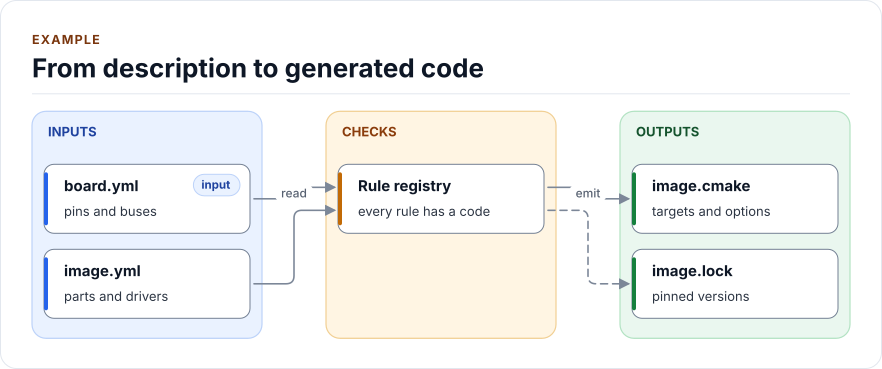
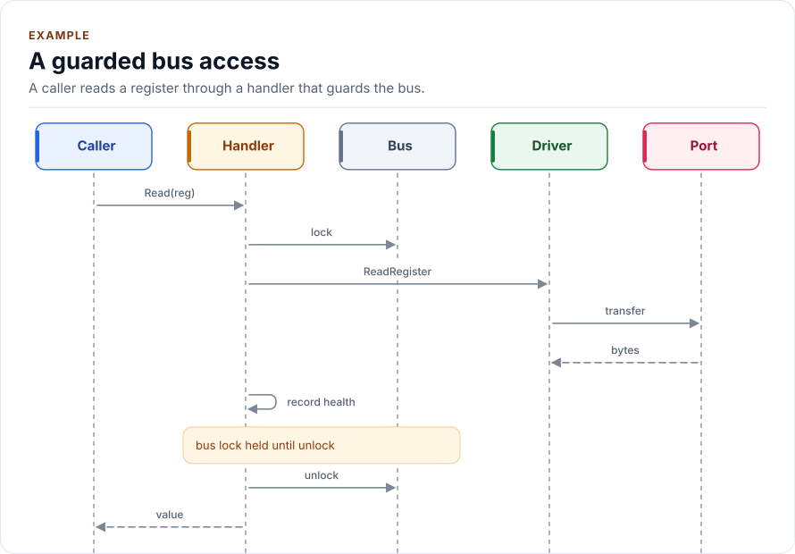
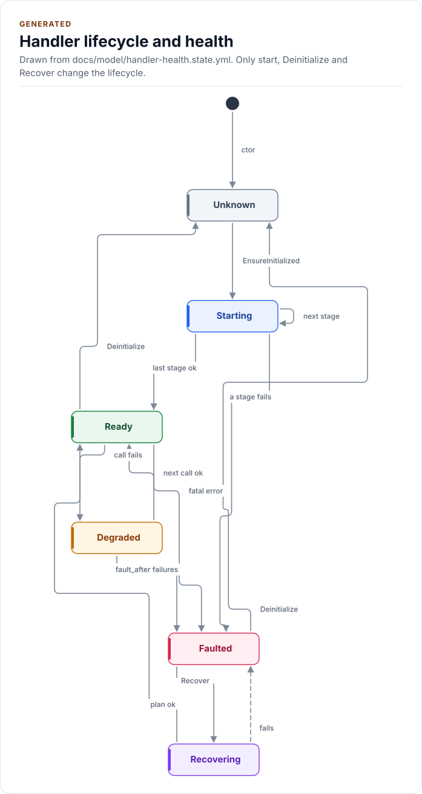
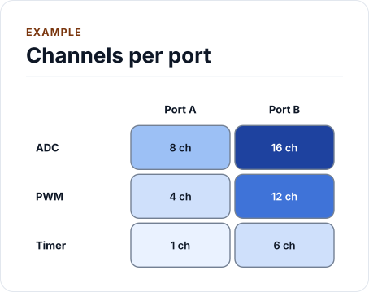
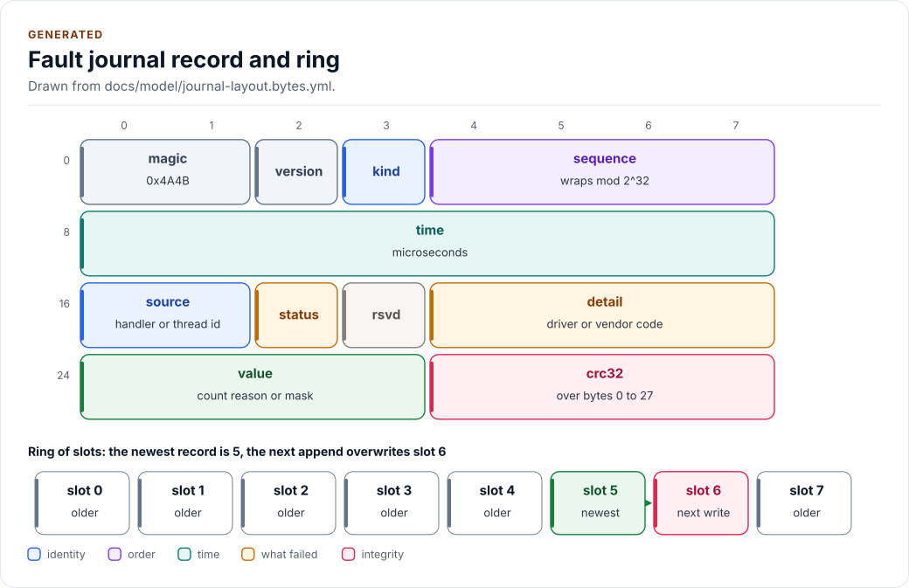
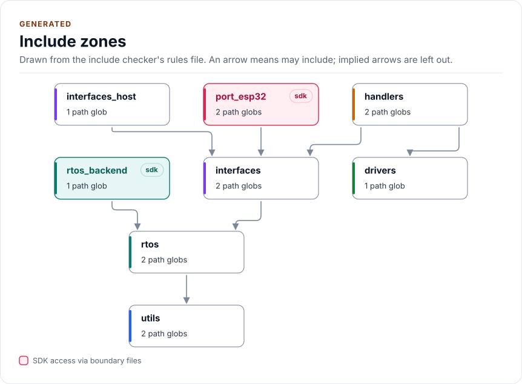
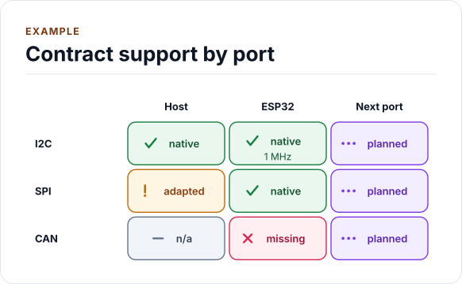
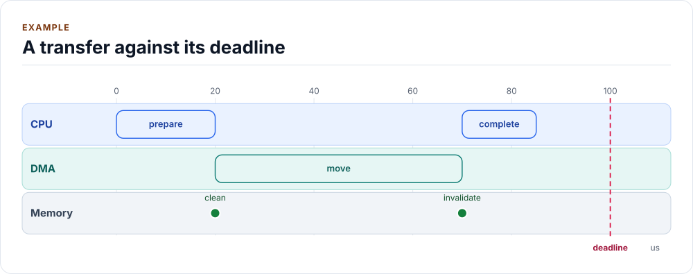
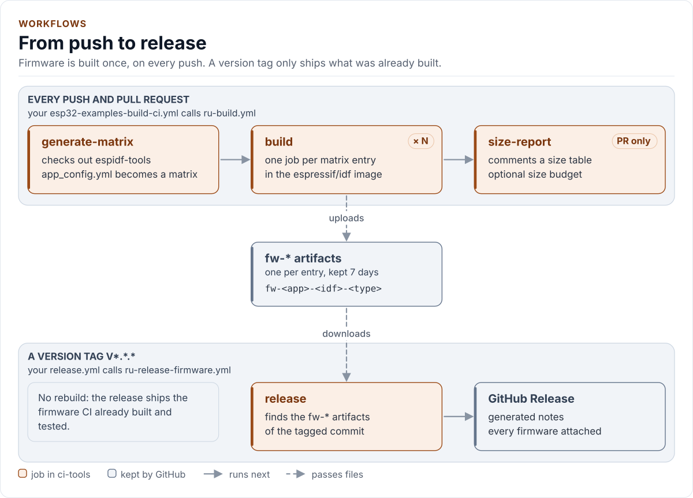
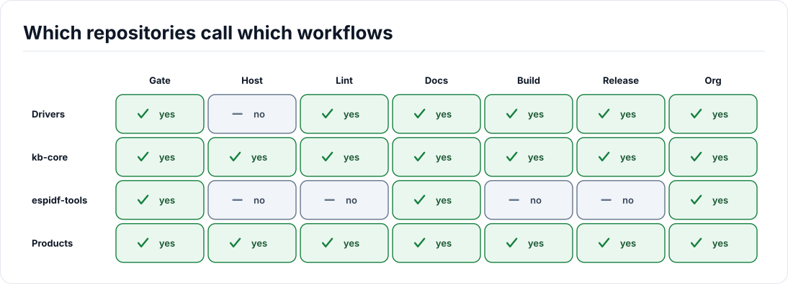

# Figures

<!-- Written by kokeb-docs figures from docs/diagrams/figures/*.py. Do not edit by hand. -->

Every figure on this site is drawn by a Python module from facts extracted from the code, so it is rebuilt,
not redrawn, when the code changes. CI runs `kokeb-docs figures --check` and fails when a
committed figure no longer matches the code. Each figure below lists the files it is drawn from.

## From description to generated code

<!-- figure: board-flow -->
<picture>
  <source media="(prefers-color-scheme: dark)" srcset="board-flow.dark.svg">
  
</picture>
<!-- /figure -->

Hardware description: [`docs/model/board-flow.pipeline.yml`](../model/board-flow.pipeline.yml)

Drawn from:

- [`docs/model/board-flow.pipeline.yml`](../model/board-flow.pipeline.yml)

## A guarded bus access

<!-- figure: bus-access -->
<picture>
  <source media="(prefers-color-scheme: dark)" srcset="bus-access.dark.svg">
  
</picture>
<!-- /figure -->

Hardware description: [`docs/model/bus-access.seq.yml`](../model/bus-access.seq.yml)

Drawn from:

- [`docs/model/bus-access.seq.yml`](../model/bus-access.seq.yml)

## Handler lifecycle and health

<!-- figure: handler-health -->
<picture>
  <source media="(prefers-color-scheme: dark)" srcset="handler-health.dark.svg">
  
</picture>
<!-- /figure -->

Hardware description: [`docs/model/handler-health.state.yml`](../model/handler-health.state.yml)

Drawn from:

- [`docs/model/handler-health.state.yml`](../model/handler-health.state.yml)

## Channels per port

<!-- figure: heat-channels -->
<picture>
  <source media="(prefers-color-scheme: dark)" srcset="heat-channels.dark.svg">
  
</picture>
<!-- /figure -->

Hardware description: [`docs/model/heat-channels.matrix.yml`](../model/heat-channels.matrix.yml)

Drawn from:

- [`docs/model/heat-channels.matrix.yml`](../model/heat-channels.matrix.yml)

## Fault journal record and ring

<!-- figure: journal-layout -->
<picture>
  <source media="(prefers-color-scheme: dark)" srcset="journal-layout.dark.svg">
  
</picture>
<!-- /figure -->

Hardware description: [`docs/model/journal-layout.bytes.yml`](../model/journal-layout.bytes.yml)

Drawn from:

- [`docs/model/journal-layout.bytes.yml`](../model/journal-layout.bytes.yml)

## Include zones

<!-- figure: layers-zones -->
<picture>
  <source media="(prefers-color-scheme: dark)" srcset="layers-zones.dark.svg">
  
</picture>
<!-- /figure -->

Hardware description: [`docs/model/layers-zones.graph.yml`](../model/layers-zones.graph.yml)

Drawn from:

- [`docs/model/layers-zones.graph.yml`](../model/layers-zones.graph.yml)

## Contract support by port

<!-- figure: port-capabilities -->
<picture>
  <source media="(prefers-color-scheme: dark)" srcset="port-capabilities.dark.svg">
  
</picture>
<!-- /figure -->

Hardware description: [`docs/model/port-capabilities.matrix.yml`](../model/port-capabilities.matrix.yml)

Drawn from:

- [`docs/model/port-capabilities.matrix.yml`](../model/port-capabilities.matrix.yml)

## A transfer against its deadline

<!-- figure: transfer-deadline -->
<picture>
  <source media="(prefers-color-scheme: dark)" srcset="transfer-deadline.dark.svg">
  
</picture>
<!-- /figure -->

Hardware description: [`docs/model/transfer-deadline.timeline.yml`](../model/transfer-deadline.timeline.yml)

Drawn from:

- [`docs/model/transfer-deadline.timeline.yml`](../model/transfer-deadline.timeline.yml)

## From push to release

<!-- figure: workflow-flow -->
<picture>
  <source media="(prefers-color-scheme: dark)" srcset="workflow-flow.dark.svg">
  
</picture>
<!-- /figure -->

Figure module: [`docs/diagrams/figures/workflow-flow.py`](../../docs/diagrams/figures/workflow-flow.py)

Drawn from:

- `jobs` in [`.github/workflows/ru-build.yml`](../../.github/workflows/ru-build.yml)
- `jobs` in [`.github/workflows/ru-release-firmware.yml`](../../.github/workflows/ru-release-firmware.yml)

## Which repositories call which workflows

<!-- figure: workflow-use -->
<picture>
  <source media="(prefers-color-scheme: dark)" srcset="workflow-use.dark.svg">
  
</picture>
<!-- /figure -->

Hardware description: [`docs/model/workflow-use.matrix.yml`](../model/workflow-use.matrix.yml)

Drawn from:

- [`docs/model/workflow-use.matrix.yml`](../model/workflow-use.matrix.yml)
