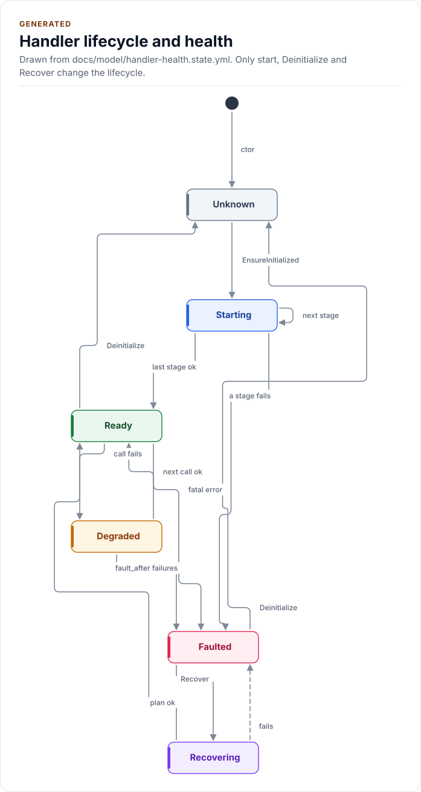
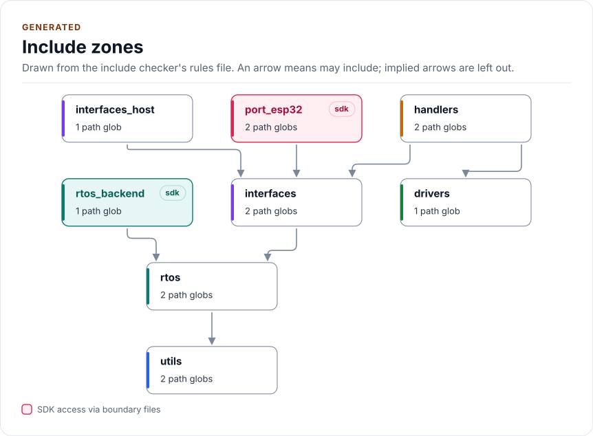
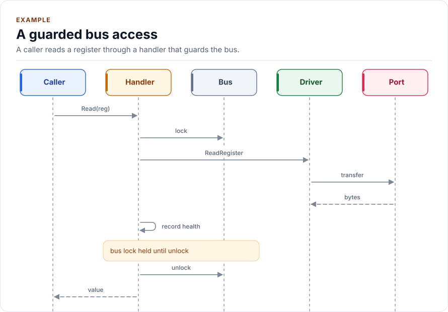
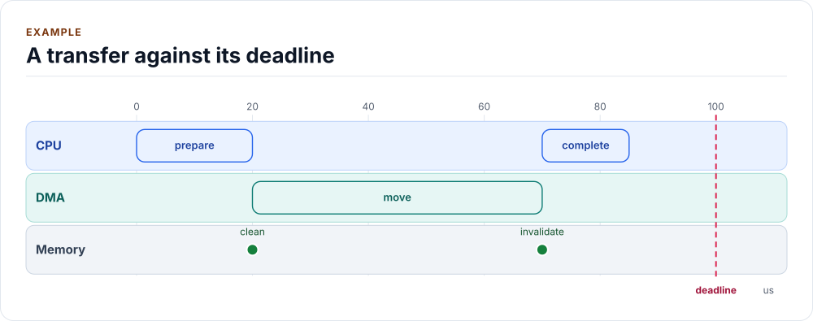
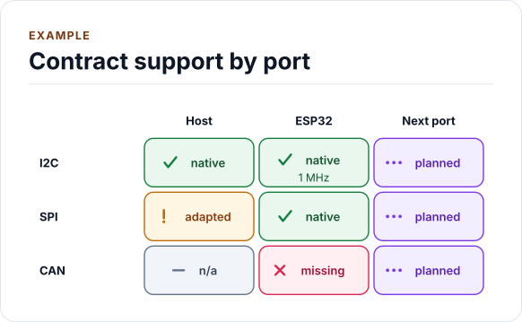
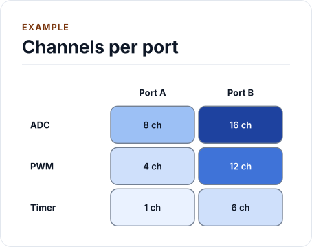
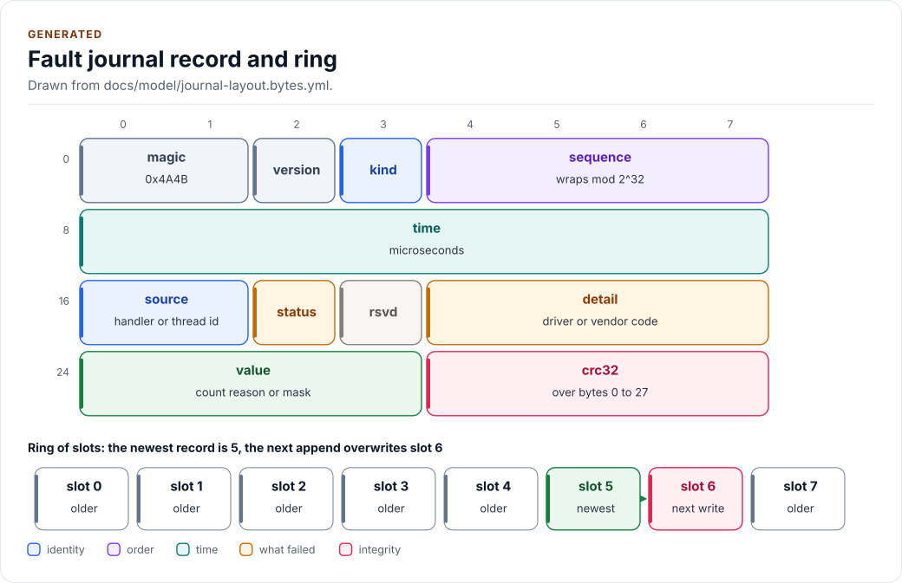
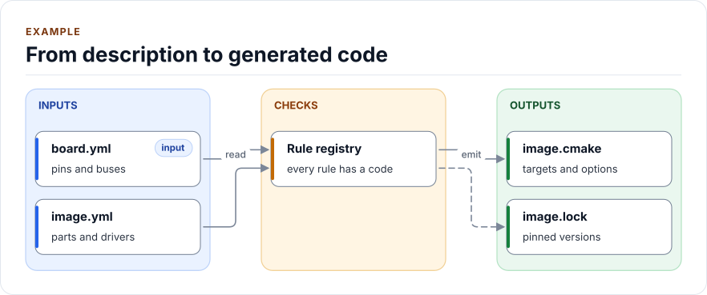

# Figures with figkit

Draw a state machine, sequence, timeline, graph, matrix, byte layout or pipeline from a small model file, and have CI
check it.

figkit is the figure kit of the theme package. A figure is either a Python module (`docs/diagrams/figures/<id>.py`,
for facts read from code) or, for the seven kinds on this page, a model file `docs/model/<id>.<kind>.yml` and nothing
else. The decision behind it is [ADR 0001](adr/0001-figure-toolchain.md).

## Add a figure

<div class="kb-steps" markdown>

1. Scaffold it: `kokeb-docs figkit new --kind state --id handler-health --page docs/design.md`. This writes
   `docs/model/handler-health.state.yml` and adds the embed marker to the page.
2. Edit the model. Write the one-sentence `alt` and the `reads` paragraph first; the scaffold's `TODO` text fails the
   build until you do.
3. For a `state` or `graph` figure, run `kokeb-docs figkit layout handler-health` once and commit
   `docs/diagrams/handler-health.layout.json`. This is the only step that needs Graphviz.
4. Run `kokeb-docs figures`, open the SVG, fix what the build flags, run `kokeb-docs figures --lint` and
   `kokeb-docs check`. Commit the model, the lock and everything under `docs/diagrams/`.

</div>

A model file starts with `---`, indents by two spaces (sequence items too) and has no padding after commas, so it
passes the organisation's yamllint configuration; the scaffold writes it that way.

Never edit an SVG, write a hex colour (use tokens such as `blue` or `ink`), put a time stamp in a model, or switch a
check off. When the nodes, edges or text sizes of a `state` or `graph` figure change, the layout lock is stale: the
build says `layout stale, run kokeb-docs figkit layout <id>`.

## The kinds

Every model starts with the same keys:

| Key | Meaning |
| --- | --- |
| `kind`, `id` | The kind, and the figure id (lower case, digits, `-`; equal to the file name's first part) |
| `title`, `kicker`, `subtitle` | Heading of the figure |
| `alt` | One sentence of 40 to 300 characters saying what the figure shows; becomes the SVG title text and every embed's alt |
| `reads` | The long description, two or more sentences naming every state, participant, lane or column |
| `width` | Minimum width in px; the figure grows to fit its content |
| `print` | `landscape` (default) or `portrait`: the A4 page the figure is checked against |
| `sources` | Files the figure is drawn from, listed in the figure catalogue |
| `legend` | `[[tone, label], ...]` swatches under the figure |
| `font` | `embed` to carry a font subset in the standalone SVGs |

Unknown keys, unknown tones, a transition to a state that does not exist, a byte covered twice: all are listed together
as errors, with the path of the key.

### State machine (`state`)

States are cards, transitions are orthogonal arrows with labels, a self transition is a loop on the side of its card,
and `[*]` is the initial or final state. `direction` is `TB` (default) or `LR`.

<!-- figure: handler-health -->
<picture>
  <source media="(prefers-color-scheme: dark)" srcset="diagrams/handler-health.dark.svg">
  
</picture>
<!-- /figure -->

```yaml
kind: state
id: handler-health
states:
  - {id: Unknown, tone: slate}
  - {id: Starting, tone: blue}
transitions:
  - {from: "[*]", to: Unknown, label: ctor}
  - {from: Unknown, to: Starting, label: EnsureInitialized}
  - {from: Starting, to: Starting, label: next stage}
```

### Layered graph (`graph`)

Cards and arrows, laid out in ranks. `reduce: true` drops an arrow that a longer path already implies. A node takes
`lines` (body text), `tag` (a pill) and `accent`.

<!-- figure: layers-zones -->
<picture>
  <source media="(prefers-color-scheme: dark)" srcset="diagrams/layers-zones.dark.svg">
  
</picture>
<!-- /figure -->

```yaml
kind: graph
id: layers-zones
reduce: true
nodes:
  - {id: rtos, tone: teal, lines: [2 path globs]}
  - {id: utils, tone: blue, lines: [2 path globs]}
edges:
  - {from: rtos, to: utils}
```

### Sequence (`seq`)

Participants in a row with lifelines; steps run downwards: a call, a return (`return: true`, dashed), a call to self,
a note over some participants.

<!-- figure: bus-access -->
<picture>
  <source media="(prefers-color-scheme: dark)" srcset="diagrams/bus-access.dark.svg">
  
</picture>
<!-- /figure -->

```yaml
kind: seq
id: bus-access
participants:
  - {id: caller, label: Caller, tone: blue}
  - {id: handler, label: Handler, tone: amber}
steps:
  - {from: caller, to: handler, label: Read(reg)}
  - {from: handler, to: handler, label: record health}
  - {note: lock held, over: [handler]}
  - {from: handler, to: caller, label: value, return: true}
```

### Timeline (`timeline`)

Swim lanes against a time axis, with spans, events and deadline lines. A figure of path cost or stack use is an
estimate: say so in `reads` ("estimate, not a worst-case claim") and make no safety claim.

<!-- figure: transfer-deadline -->
<picture>
  <source media="(prefers-color-scheme: dark)" srcset="diagrams/transfer-deadline.dark.svg">
  
</picture>
<!-- /figure -->

```yaml
kind: timeline
id: transfer-deadline
axis: {unit: us, min: 0, max: 110, ticks: [0, 50, 100]}
lanes:
  - {id: cpu, label: CPU, tone: blue}
spans:
  - {lane: cpu, from: 0, to: 20, label: prepare, tone: blue}
deadlines:
  - {at: 100, label: deadline}
```

### Matrix and heat map (`matrix`)

A grid with a word and a drawn mark in every status cell (`ok`, `warn`, `fail`, `na`, `planned`), so colour is never the
only carrier. A cell with `value` instead of `status` is a heat cell: its number is written in it and its fill steps
through a five colour ramp. A table twin `<id>.table.html` is written from the same cells.

<!-- figure: port-capabilities -->
<picture>
  <source media="(prefers-color-scheme: dark)" srcset="diagrams/port-capabilities.dark.svg">
  
</picture>
<!-- /figure -->

<!-- figure: heat-channels -->
<picture>
  <source media="(prefers-color-scheme: dark)" srcset="diagrams/heat-channels.dark.svg">
  
</picture>
<!-- /figure -->

```yaml
kind: matrix
id: port-capabilities
rows: [{id: i2c, label: I2C}]
cols: [{id: host, label: Host}, {id: esp, label: ESP32}]
cells:
  - {row: i2c, col: host, status: ok, text: native}
  - {row: i2c, col: esp, status: planned, text: planned, note: later}
```

### Byte layout (`bytes`)

A record in rows of `row_bytes` bytes, each field a card over its bytes; every byte must belong to exactly one field.
An optional `ring` draws a row of slots with the newest and the next write marked. The table twin lists the fields.

<!-- figure: journal-layout -->
<picture>
  <source media="(prefers-color-scheme: dark)" srcset="diagrams/journal-layout.dark.svg">
  
</picture>
<!-- /figure -->

```yaml
kind: bytes
id: journal-layout
row_bytes: 8
size: 16
fields:
  - {at: 0, len: 2, name: magic, note: "0x4A4B", tone: slate}
  - {at: 2, len: 6, name: payload, tone: blue}
```

### Pipeline (`pipeline`)

Columns of stages with arrows between neighbouring columns.

<!-- figure: board-flow -->
<picture>
  <source media="(prefers-color-scheme: dark)" srcset="diagrams/board-flow.dark.svg">
  
</picture>
<!-- /figure -->

```yaml
kind: pipeline
id: board-flow
columns:
  - id: inputs
    title: Inputs
    tone: blue
    items:
      - {id: board, title: board.yml, lines: [pins and buses]}
  - id: outputs
    title: Outputs
    tone: green
    items:
      - {id: cmake, title: image.cmake}
links:
  - {from: board, to: cmake, label: emit}
```

## Commands

| Command | Does |
| --- | --- |
| `kokeb-docs figkit kinds` | Lists the kinds |
| `kokeb-docs figkit new --kind K --id ID [--page P]` | Scaffolds a model and, with `--page`, its embed marker |
| `kokeb-docs figkit layout [ID...] [--check]` | Runs Graphviz and writes the layout locks; `--check` only reports where the installed `dot` would change a committed lock (advisory, exit 0) |
| `kokeb-docs figkit font [ID...]` | Writes the font subsets of figures with `font: embed` (needs the `fonts` extra) |
| `kokeb-docs figkit css [OUT]` | The shared style sheet for adaptive SVGs inlined in a page |
| `kokeb-docs figures [--check]` | Draws every figure and writes, or checks, the outputs; never runs Graphviz |
| `kokeb-docs figures --lint [--ban-mermaid]` | All findings: SVG, alt text, shape contrast, print fit, Mermaid fences; with `--ban-mermaid` a fence anywhere (README files too) or a `.mmd` file is an error. `kokeb-docs check` runs it with `--ban-mermaid` unless the site configuration sets `extra: {no_mermaid: false}` |

## Checks

| Check | Rule | Fails the build for |
| --- | --- | --- |
| Text contrast | 4.5:1 in both themes | every figure |
| Fit | text inside its card and the figure, no overlapping cards, no arrow under a card or across text | every figure |
| Shape contrast | 3:1 for the outline of a card, an arrow, a stripe, a status mark | palette 2 figures (warnings for older ones in `--lint`) |
| Print fit | smallest text at least 7 pt when the figure is scaled to an A4 content width (510 pt portrait, 757 pt landscape) | palette 2 figures with a `print` mode |
| SVG lint | `viewBox`, `role="img"`, title and description, no script, event handler, `style=` or external reference, ids start with the figure id, at most 60 KB | palette 2 figures; any defect shows in `--lint` |
| Alt lint | one sentence, 40 to 300 characters, not "image of" or "diagram of", differs from the title; the long description has two sentences and names every state, participant, lane and column | palette 2 figures |
| Golden bytes | every committed output equals a fresh build | every figure |
| Layout and font locks | the lock was made from the figure's current inputs | model figures |

## Adaptive output

`<id>.adaptive.svg` is one file for both themes. Its colours are classes over custom properties. The theme is
chosen by `data-theme="light|dark"` on the page's root element, then by Material's colour scheme, then by the reader's
`prefers-color-scheme`; in forced-colors mode the figure uses system colours. Inside an `` only the operating
system preference applies, so a page that wants its own toggle inlines the SVG. A page with a strict content security
policy inlines the form made with `embed_style=False` and links the sheet from `kokeb-docs figkit css`.

## Palette versions

`palette=1` is the original palette and is the default for figures written with the Python calls, so their bytes did
not change when the kinds arrived. `palette=2` (used by every model figure) changes three base tokens so that shapes
that carry meaning reach 3:1, and adds status and heat tokens:

| Token | Palette 1 (light, dark) | Palette 2 (light, dark) |
| --- | --- | --- |
| `line` | `#C9D1DB`, `#3A4657` (1.54:1) | `#738093`, `#6C7889` (3.7:1 or more) |
| `rail` | `#8893A2`, `#6C7889` | `#7C8798`, `#6C7889` |
| `stone.strong` | `#B5AFA9`, `#57534E` (2.17:1) | `#857F79`, `#8C8780` |
| `ok`, `warn`, `fail`, `na`, `planned`, `h0` to `h4` | not available | text 4.5:1 on their tint, stroke 3:1 |

An existing Python figure opts in with `Fig(..., palette=2)`; marker ids then start with the figure id. Making palette 2
the default will be announced under **Breaking** in the changelog and ships in a major release.

## Python API

```python
from kokeb_mkdocs_theme.figkit import Fig                  # the original calls, unchanged
from kokeb_mkdocs_theme.figkit.kinds import from_model     # a model file (or dict) to a finished Fig

fig = from_model("docs/model/handler-health.state.yml")    # reads the layout lock, never runs Graphviz
```

A figure module can wrap a model: `def build(_data): return from_model("docs/model/x.state.yml")`, with
`SOURCES = ["docs/model/x.state.yml"]`.
