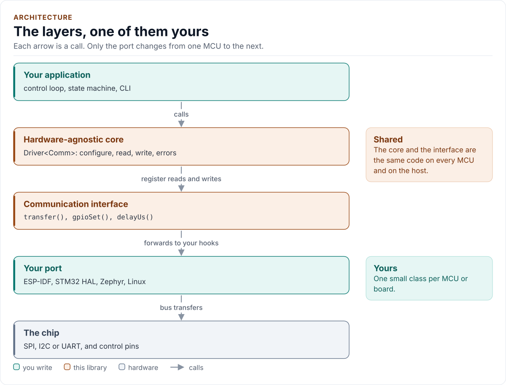

# Architecture

How the driver is built: hardware-agnostic core, communication interface, platform port.

<!-- Write this page to docs/DOCS-STYLE-GUIDE.md (page "Architecture"). -->

<!-- figure: driver-layers -->
<picture>
  <source media="(prefers-color-scheme: dark)" srcset="diagrams/driver-layers.dark.svg">
  
</picture>
<!-- /figure -->
