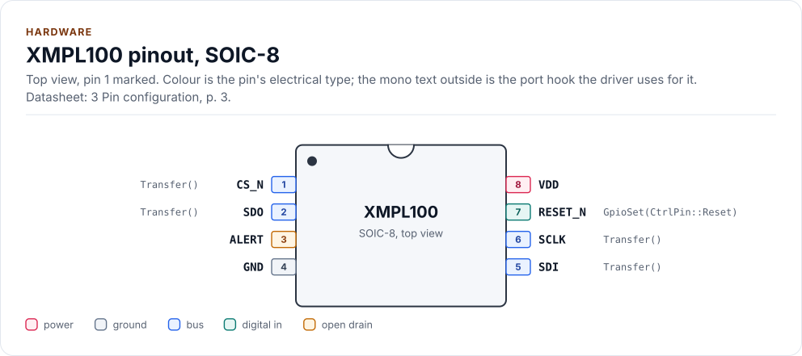
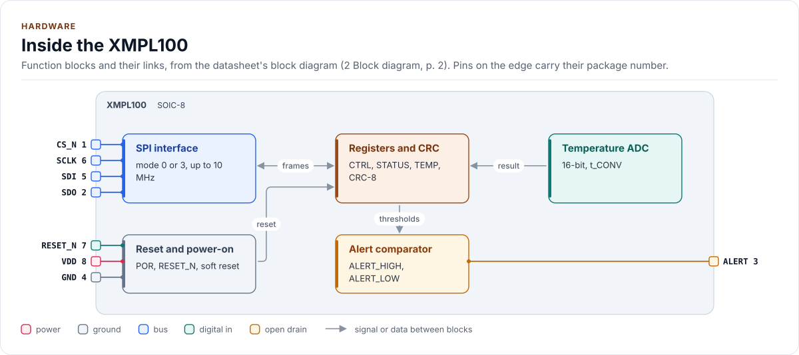
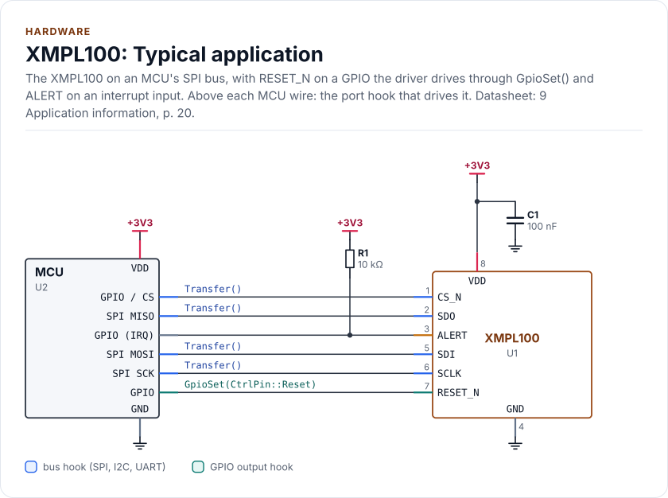

# Hardware

What to connect, with which bus settings and timing, and the board-level traps.

<!-- Write this page to docs/DOCS-STYLE-GUIDE.md (page "Hardware"). The pinout, the block diagram, the circuit,
     the pin table and the parts table below are drawn from docs/hardware.yml: edit that file, then run
     `kokeb-docs figures && kokeb-docs gen`. -->

## Pins

<!-- figure: chip-pinout -->
<picture>
  <source media="(prefers-color-scheme: dark)" srcset="diagrams/chip-pinout.dark.svg">
  
</picture>
<!-- /figure -->

<!-- generated: chip-pins -->
SOIC-8, 8 pins (3 Pin configuration, p. 3).

| Pin | Name | Type (domain) | Function | Driver hook | If unused | Datasheet |
| --- | --- | --- | --- | --- | --- | --- |
| 1 | `CS_N` | bus (VDD) | SPI chip select, active low | `Transfer()` | - | 6.2, p. 8 |
| 2 | `SDO` | bus (VDD) | SPI data out (MISO); high impedance while CS_N is high | `Transfer()` | - | 6.2, p. 8 |
| 3 | `ALERT` | open drain (VDD) | Threshold alert, open drain; read STATUS when it fires | - | Leave open | 7.7, p. 15 |
| 4 | `GND` | ground | Ground | - | - | 3, p. 3 |
| 5 | `SDI` | bus (VDD) | SPI data in (MOSI) | `Transfer()` | - | 6.2, p. 8 |
| 6 | `SCLK` | bus (VDD) | SPI clock, up to 10 MHz | `Transfer()` | - | 6.2, p. 8 |
| 7 | `RESET_N` | digital in (VDD) | Hardware reset, active low, internal 100 kΩ pull-up | `GpioSet(CtrlPin::Reset)` | Leave open | 8.3, p. 18 |
| 8 | `VDD` | power (VDD) | Supply, 1.8 V to 3.6 V | - | - | 5, p. 5 |

Source of this table and of the chip figures: [`docs/hardware.yml`](hardware.yml).
<!-- /generated -->

## Inside the chip

<!-- figure: chip-blocks -->
<picture>
  <source media="(prefers-color-scheme: dark)" srcset="diagrams/chip-blocks.dark.svg">
  
</picture>
<!-- /figure -->

## Typical application

<!-- figure: chip-circuit-typical -->
<picture>
  <source media="(prefers-color-scheme: dark)" srcset="diagrams/chip-circuit-typical.dark.svg">
  
</picture>
<!-- /figure -->

<!-- generated: chip-parts -->
| Part | Kind | Value | Connects | Datasheet |
| --- | --- | --- | --- | --- |
| U2 | MCU | - | VDD: +3V3, GND: GND, SCK: SCLK, MOSI: SDI, MISO: SDO, CS: CS_N, RST: RESET_N, IRQ: ALERT | 9, p. 20 |
| C1 | capacitor | 100 nF | +3V3, GND | 5, p. 5 |
| R1 | resistor | 10 kΩ | +3V3, ALERT | 7.7, p. 15 |

Export a circuit for a schematic or PCB tool: `kokeb-docs hardware --kicad-netlist OUT.net --circuit typical`.
<!-- /generated -->
